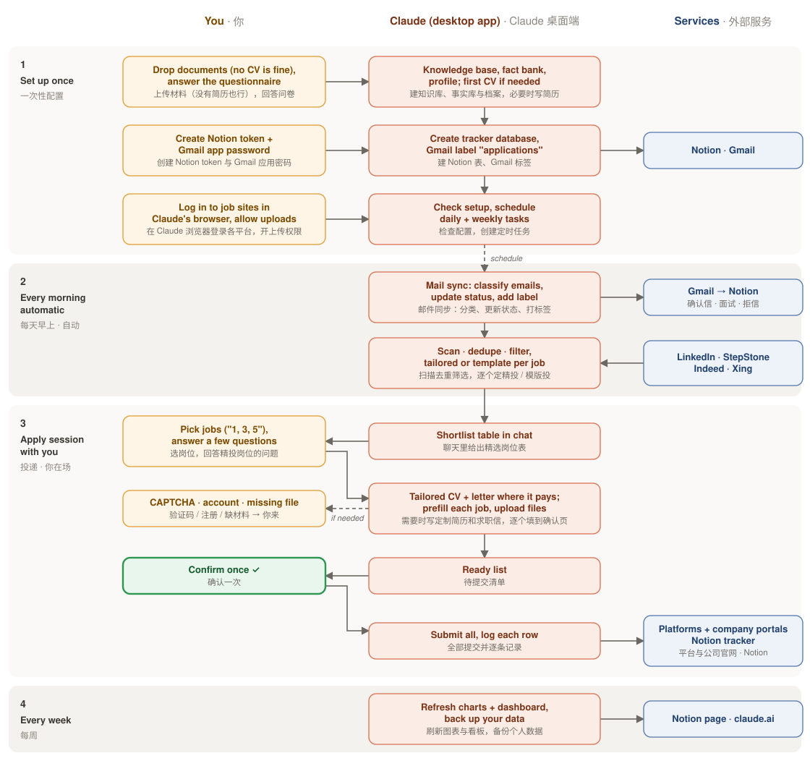
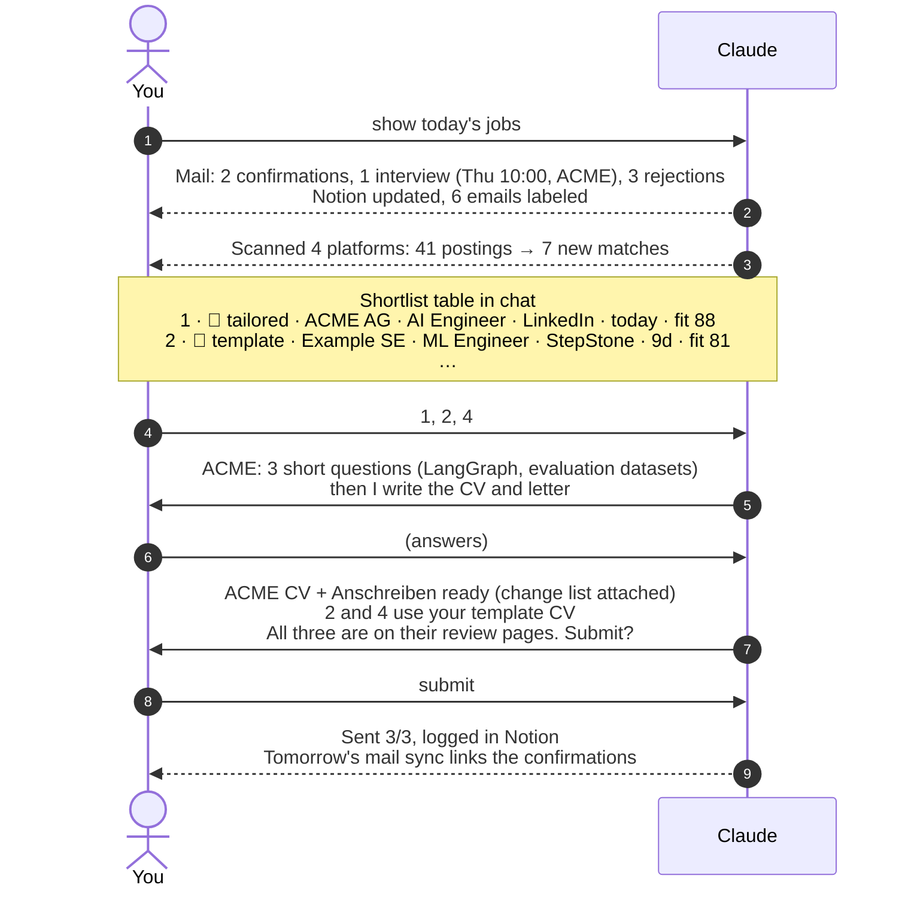
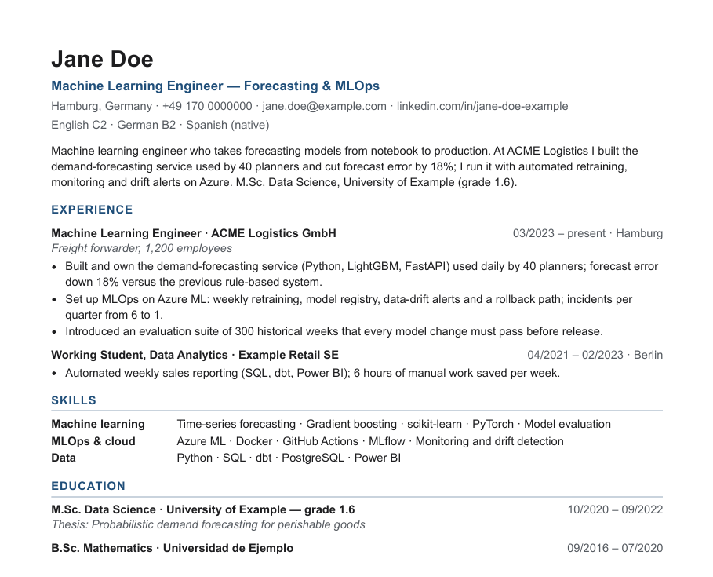
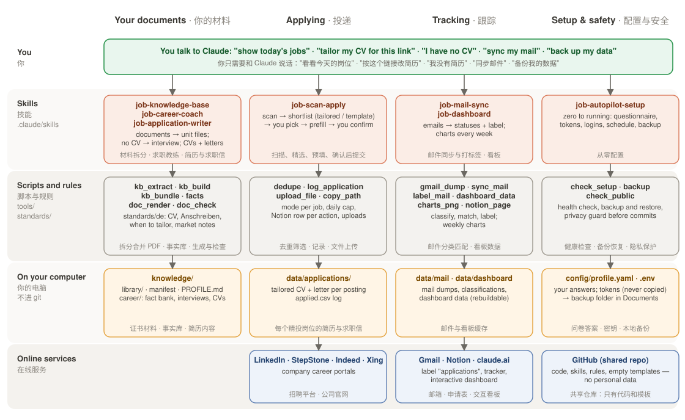
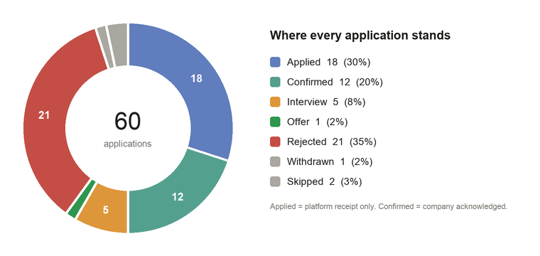
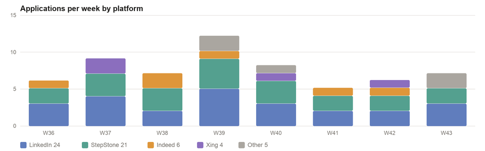
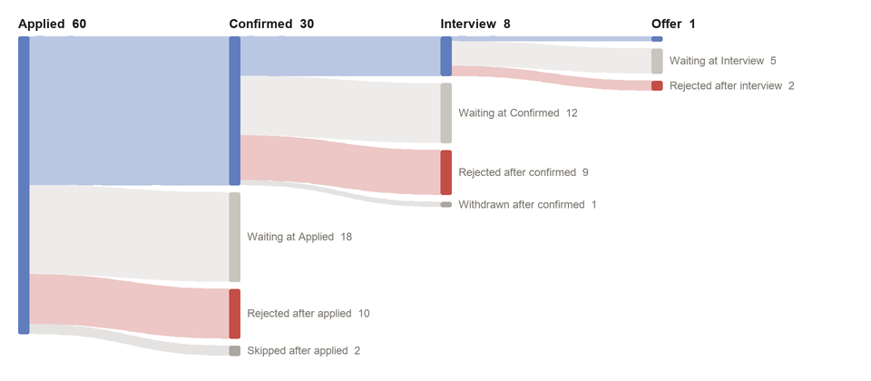
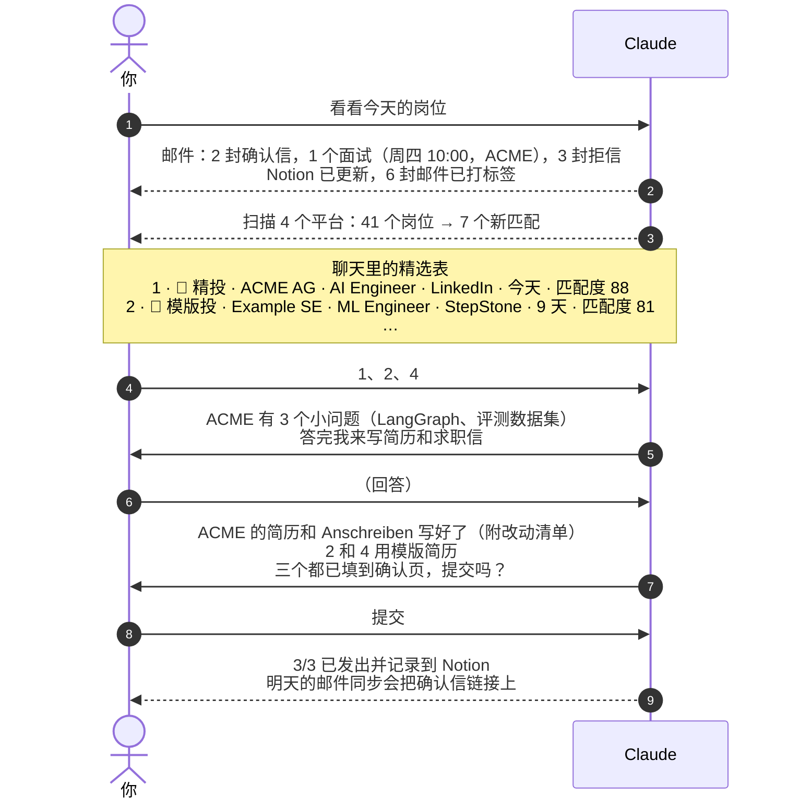

# Job Autopilot for Claude

**Daily job scan, one-confirmation batch applying, an inbox that updates your tracker, and dashboards — 
set up and run by talking to the Claude desktop app. No coding needed.**

**每日扫描岗位 · 一次确认批量投递 · 邮件自动更新申请表 · 可视化看板 —— 
全部通过和 Claude 桌面端对话完成，不需要会写代码。**

[English](#english) · [中文](#中文)

Editable source: <a href="docs/diagram/flow.drawio">docs/diagram/flow.drawio</a> (open in draw.io / diagrams.net)

---

## English

### What it does
- **Scans** LinkedIn, StepStone, Indeed and Xing every morning, removes jobs you have already seen, and filters by your rules
  (company size, salary, posting age, fit, cover-letter requirement, daily cap). Not happy with the list? Say "show more" and the
  filters widen for that run only.
- **Shows you a shortlist table** in chat. You pick, Claude fills every application up to its review page — including
  company career sites that need file uploads — and **submits only after you confirm once**. Prefer less clicking? Say
  "submit directly" for a batch: Claude then fills everything, ticks the declaration boxes a form itself requires, submits, and
  leaves only what a machine must not do (CAPTCHAs and "I am human" checks, logins, creating accounts) to you, in one list.
- **Keeps every job description**: before each submit the posting is saved on your computer (clean text, a readable PDF and
  the page as loaded). Postings vanish within weeks; when the interview invitation arrives, the description is still there.
  Older applications can be backfilled; closed postings are marked as such.
- **Reads your application inbox** daily: confirmations, interview invitations, rejections and offers update a
  **Notion tracker**; every application links to its first email as evidence; every application email gets the Gmail label
  **`applications`**. Applications you sent by hand are detected and Claude asks you to confirm them.
- **Knowledge base**: drop every document you have — scans, merged PDFs, photos. Claude reads each page, splits them into
  one-document unit files, names them, and writes a profile of what each document proves and what is missing.
  At application time it decides per form which files go into which upload slot, merged or separate, in German standard order.
- **No CV? No experience?** A career coach reads your transcript and degree, interviews you in short rounds about projects,
  jobs and skills, recommends realistic target roles with real postings as evidence, explains how the market works
  (language, Werkstudent / internship / junior routes, work permits) and writes your first CVs.
- **CVs and cover letters that fit the posting**: every job in the shortlist gets a mode — 🎯 *tailored* for fresh, high-fit
  postings and dream companies, 📄 *template* (your role-family CV) for the rest. Tailored means a requirement match table,
  a few questions to close gaps, a CV written for that posting and a cover letter in German or English — built only from a
  fact bank you confirmed, checked for consistent dates and numbers, readable by applicant-tracking systems. Written for
  the recruiter first: rare project, method and model names stay but get a plain-language label (e.g. "reinforcement-learning
  algorithm (Double DQN)"), and a stack shared by several projects is named once per position, not repeated.
- **Dashboards**: a section on your Notion page (stage pie, stage flow, applications per week, interview rate by mode and
  posting age) and an interactive claude.ai dashboard, refreshed weekly.

### What you need
| | |
|---|---|
| A Mac or Windows PC with the **Claude desktop app** (Code tab) | the built-in browser is used; file uploads on company sites: [docs/file-uploads.md](docs/file-uploads.md) |
| A **Gmail** inbox you apply with | read access via an app password; only adds a label |
| A **Notion** account | free plan is fine |
| Accounts on the job sites you use | you log in once inside Claude's browser |
| About 45 minutes once | then a few minutes a day |

### Get started
1. Open the Claude desktop app → **Code** tab, and say:
   > Clone https://github.com/Zmx1122/claude-job-autopilot into my Documents folder, open it, and set up job autopilot.

   (Or download the ZIP from GitHub, unzip it, and open the folder in the Code tab.)
2. Claude walks you through a few short steps (the `job-autopilot-setup` skill):
   restore an earlier backup (if you have one) → documents (no CV yet? Claude interviews you and writes one) → questionnaire →
   Notion token → Gmail app password + label → logins → file uploads → dashboards → schedule → backup → final check.
   Every click is explained in [docs/credentials.md](docs/credentials.md) and [docs/file-uploads.md](docs/file-uploads.md).
3. From then on, each morning: open Claude and say **"show today's jobs"**.

### What you can say
| Say … | Claude … |
|---|---|
| "set up job autopilot" | runs the guided setup (or restores your backup) |
| "show today's jobs" / "scan" | syncs your mail, scans the job sites, shows the shortlist with 🎯 / 📄 modes |
| "show more" / "widen the search" / "no salary filter" | re-runs the filters on today's scan with a wider net for this run only (salary off, 7 or 14 days, lower fit, earlier shortlist again) — your profile stays unchanged |
| "1, 3, 5" → "submit" | prefills the picked jobs, then submits after your one confirmation |
| "tailor my CV for [job link]" | match table, a few gap questions, CV + cover letter for that posting |
| "does my CV fit [job link]?" | quick fit check and the closest CV you already have |
| "I have no CV" / "what jobs fit me?" | career coaching: interview, target roles with real postings, first CV |
| "add these documents" | splits and indexes new certificates, updates your knowledge profile |
| "save the job descriptions of my applications" | snapshots every tracked posting that is not saved yet (and marks closed ones) |
| "sync my mail" | updates Notion from your inbox and labels application emails |
| "show the dashboard" | refreshes Notion charts and the interactive dashboard |
| "back up my data" / "restore my data from …" | saves or restores your personal data folder |

### A normal day

Illustrative conversation. The table and numbers are examples.

### What a tailored application looks like
For a 🎯 posting Claude first shows how you match, asks about the gaps, then writes the CV (and letter) and checks it.

| Requirement (posting) | Must / Nice | Status | Evidence from your fact bank |
|---|---|---|---|
| Production ML forecasting | Must | ✅ | demand-forecasting service, 40 planners, error −18% |
| MLOps on a cloud platform | Must | ✅ | Azure ML retraining, registry, drift alerts |
| Kubernetes | Nice | ⚠️ | → question: *"Have you deployed anything on Kubernetes, even in a side project?"* |
| German C1 | Must | ❌ | B2 → mentioned honestly, no CV change |

Fictional sample (<a href="docs/sample/cv-jane-doe.yaml">content</a> → <a href="docs/sample/Jane-Doe-CV-Nordwind.pdf">PDF</a>): one column, real text, every line from confirmed facts; a change list and a consistency check come with it.

### What's inside

Editable source: <a href="docs/diagram/modules.drawio">docs/diagram/modules.drawio</a>

### Modules
| Module | Where | What |
|---|---|---|
| Knowledge base | `.claude/skills/job-knowledge-base`, `tools/kb_extract.py`, `kb_build.py`, `kb_bundle.py` | inbox → unit files in `knowledge/library/` + `manifest.yaml` + `PROFILE.md`; merge/separate files per upload slot (never committed) |
| Questionnaire | `config/profile.example.yaml` → `config/profile.yaml` | personal data, search, rules, strategy, standard answers |
| Career coach | `.claude/skills/job-career-coach`, `tools/facts.py` | no CV → documents + interview → fact bank, target roles (`DIRECTION.md`), first CVs |
| CV & cover-letter writer | `.claude/skills/job-application-writer`, `tools/doc_render.py`, `tools/doc_check.py`, `templates/` | master CV, one CV per role family, tailored CV + letter per posting; ATS-readable PDFs; consistency and screener-wording check |
| Country standards | `standards/de/` | what a strong German CV and Anschreiben look like, when to tailor, market notes for newcomers |
| Scan & apply | `.claude/skills/job-scan-apply`, `tools/dedupe.py`, `tools/filters.py`, `tools/log_application.py` | shortlist → pick → prefill → confirm → submit |
| Job-description snapshots | `tools/jd_snapshot.py` | each posting → `data/applications/<date>_<company>_<title>/` (`jd.md`, `jd.pdf`, page copy); `--backfill` for older applications |
| Mail sync & label | `.claude/skills/job-mail-sync`, `tools/gmail_*.py`, `tools/sync_mail.py`, `label_mail.py`, `merge.py`, `split_for_classify.py` | classify emails, update Notion, label `applications`, detect manual applications, backfill |
| Notion tracker | `tools/notion_setup.py`, `log_application.py`, `notion_upsert.py` | creates the database ([schema](docs/data-model.md)), logs and updates one row per job |
| Dashboards | `.claude/skills/job-dashboard`, `tools/refresh_dashboards.sh`, `dashboard_data.py`, `charts_png.py`, `notion_page.py`, `dashboard/index.html` | Notion charts + interactive claude.ai dashboard |
| File uploads | `tools/upload_file.sh`, `tools/copy_path.py`, `tools/upload_test.html`, [docs/file-uploads.md](docs/file-uploads.md), [docs/macos-permissions.md](docs/macos-permissions.md) | macOS: drives the Open dialog · Windows: Claude in Chrome's upload tool · anywhere: paste a copied path |
| Backup | `tools/backup.py` | your personal data → a local folder with version history; restore after a new download |
| Privacy guard | `tools/check_public.py`, `.githooks/` | blocks commits that would publish your name, contacts, employers or tokens |
| Health check | `tools/check_setup.py` | one checklist for everything above |

### Dashboards (sample data)

### Your data stays yours
The repo you download contains only code, skills, rules and empty templates. Everything personal — answers, documents,
fact bank, CVs, cover letters, saved job descriptions, application log — lives in git-ignored folders on your computer and is copied, with
version history, to a normal folder you can open: **`Documents/Job Autopilot Data`**. New computer or fresh download?
Say *"restore my data from Documents/Job Autopilot Data"*. Passwords and tokens are never copied; keep them in a password manager.

### Boundaries
- Nothing is submitted for a job you did not pick. By default you confirm once per batch; if you say "submit directly", Claude submits as
  soon as a form is filled — for that batch only. One-click buttons are listed first and clicked only after you pick them.
- You type passwords, solve CAPTCHAs and "I am human" checks (including codes a portal emails you to prove that), create portal accounts and click
  account-creating verification links. Claude does not; it finishes everything else and lists these steps for you.
  Declaration boxes a form requires to submit ("I confirm the information is true") are ticked in "submit directly" mode; optional
  newsletter / talent-pool boxes are not.
- Only the documents a form requires are uploaded. A required cover letter is drafted for that posting and sent only after you approve it (or such jobs are skipped — your choice).
- CVs and letters contain only facts you confirmed; nothing is invented, numbers and durations are checked across documents.
- Credentials stay in `.env` on your Mac (git-ignored, not in the backup, and the commit guard blocks them). Best: paste a token into `.env`
  yourself. You may also paste it into the chat — Claude writes it to `.env` and never repeats it — but then it is part of the conversation
  history, a leak risk you accept (revoke and re-create it afterwards if you are unsure). Your CVs, answers and logs are git-ignored.
- Job sites' terms often restrict automated use. This project keeps a human choosing and confirming every batch and
  enforces a daily cap; you are responsible for how you use it.

### Lessons learned
Everything that broke while building this — wrong browser, instant one-click submits, React dropdowns, uploads in shadow DOM,
lost macOS permissions, merged PDFs, ambiguous email receipts, login walls and timed-out forms — and the fix: **[docs/pitfalls.md](docs/pitfalls.md)**.
Platform-by-platform behaviour: **[docs/platforms.md](docs/platforms.md)**.

### Roadmap
- Interview tips from the invitation: work out who will interview you (their role and function) and give tips tailored to them.
- Standards for more countries (`standards/<country>/`) and a LinkedIn profile review.

### FAQ
- **Windows?** Built for it, but exercised end to end on macOS only. Notes: PDF writing needs Chrome, Edge or Brave (set `CHROME_PATH`
  if it is not found); file uploads on company sites use **Claude in Chrome** (no system permission, but its upload tool has had
  reliability reports in 2026) or the path Claude copies for you to paste — see [docs/file-uploads.md](docs/file-uploads.md).
  `tools/refresh_dashboards.sh` is a zsh script; on Windows Claude runs the four Python commands it contains one by one.
- **Is the file uploader a separate app?** No. On macOS it is a short AppleScript in this repo (`tools/upload_file.sh`)
  run by the built-in `osascript`; it only needs the Accessibility permission for Claude.
- **Other inboxes than Gmail?** The scripts use IMAP plus Gmail labels; other providers need small changes in `tools/common.py`.
- **I have no CV / never applied for a job.** Say "I have no CV" — the career coach starts from your transcript and degree.
- **Other countries / job sites?** Add search URLs and behaviour to `docs/platforms.md` and a `standards/<country>/` folder; the skills read both.

---

## 中文

### 它能做什么
- **每天早上扫描** LinkedIn、StepStone、Indeed、Xing，去掉看过的岗位，按你的规则筛选（公司规模、薪资、发布时间、匹配度、是否强制求职信、每日上限）。对结果不满意就说"再多一点"，只对这一次放宽条件。
- **在聊天里给你一张精选岗位表**。你挑选后，Claude 把每个申请填到最后确认页（包括需要上传文件的公司官网），**你确认一次才统一提交**。想少点几下？对某一批说"直接投递"：Claude 填完就提交，表单自带的必选声明框也会勾上，只把机器不该做的事留给你并列成一张清单（验证码和"我是人类"验证、登录、注册账号）。
- **保存每个岗位的 JD**：每次提交前，岗位描述都会存到你的电脑上（干净的正文、可读的 PDF 和网页原样）。岗位几周后就会下架，
  等面试邀请来的时候，JD 还在。以前的申请可以补存，已下架的岗位会被标出来。
- **每天读取投递邮箱**：确认信、面试邀请、拒信、offer 自动更新 **Notion 申请表**；每条申请链接到第一封投递邮件作为证据；
  所有申请邮件自动打上 Gmail 标签 **`applications`**（没有这个标签会引导你创建）。你自己手动投的申请会被发现，Claude 向你确认。
- **知识库**：把所有材料丢进来（扫描件、合并 PDF、照片都行）。Claude 逐页阅读，拆成"一份文件一个文档"的单元文件并统一命名，
  生成知识库画像：每个文档是什么、证明了哪些能力、还缺什么。投递时按表单的上传入口决定哪些文件合并、哪些分开、按什么顺序。
- **没有简历、没有求职经验？** 求职教练先读你的成绩单和学位证，再分几轮简短提问，挖出项目、工作和技能，用真实岗位作证据
  推荐现实可行的目标岗位，讲清市场规则（语言、Werkstudent / 实习 / Junior 等入口、工作许可），并写出你的第一版简历。
- **贴合岗位的简历和求职信**：精选表里每个岗位都有模式——新鲜、高匹配的岗位和梦中情司走 🎯 *精投*，其余用 📄 *模版投*
  （按岗位类别准备的简历）。精投包括：岗位要求对照表、几个补缺口的问题、为该岗位写的简历和德/英文求职信。
  所有内容只来自你确认过的事实库，自动核对日期和数字是否一致，PDF 能被招聘系统（ATS）正确读取。措辞先照顾 HR：冷僻的项目名、方法名、模型名都保留，但旁边加一句通用说明（如"强化学习算法（Double DQN）"）；多个项目共用的技术栈在一段经历里只写一次，不重复。
- **看板**：Notion 页面里的图表区（阶段饼图、阶段流向图、每周投递数、按投递模式和岗位新鲜度的面试率）+ 一个 claude.ai 交互看板，每周更新数据。

### 需要准备
| | |
|---|---|
| 一台 Mac 或 Windows 电脑 + **Claude 桌面端**（Code 标签页） | 用到内置浏览器；公司官网的文件上传见 [docs/file-uploads.md](docs/file-uploads.md) |
| 用于投递的 **Gmail** | 通过应用专用密码只读访问，只会添加标签 |
| **Notion** 账号 | 免费版即可 |
| 各招聘平台账号 | 在 Claude 内置浏览器里登录一次 |
| 一次性约 45 分钟 | 之后每天几分钟 |

### 开始使用
1. 打开 Claude 桌面端 → **Code** 标签页，对它说：
   > 把 https://github.com/Zmx1122/claude-job-autopilot 克隆到我的 Documents 文件夹，打开它，然后帮我配置 job autopilot。

   （也可以在 GitHub 下载 ZIP，解压后在 Code 标签页打开该文件夹。）
2. Claude 会带你走完几个小步骤（`job-autopilot-setup` skill）：
   从旧备份恢复（如果有）→ 上传材料（还没有简历？Claude 先采访你、帮你写出来）→ 回答问卷 → Notion token →
   Gmail 应用密码和标签 → 登录各平台 → 文件上传方式 → 看板 → 定时任务 → 备份 → 最终检查。
   每一步点哪里都写在 [docs/credentials.md](docs/credentials.md) 和 [docs/file-uploads.md](docs/file-uploads.md)。
3. 之后每天早上打开 Claude 说 **"看看今天的岗位"** 即可。

### 可以对 Claude 说什么
| 你说 … | Claude 会 … |
|---|---|
| "帮我配置 job autopilot" | 带你完成配置（或从备份恢复） |
| "看看今天的岗位" / "扫岗位" | 同步邮件、扫描各平台，给出带 🎯 / 📄 模式的精选表 |
| "再多一点" / "放宽范围" / "不要按薪资过滤" | 用更宽的条件重新筛今天的扫描结果，只对这一次生效（关闭薪资、放到 7 或 14 天、降低匹配度、重新显示之前入选的），不改你的 profile |
| "1、3、5" → "提交" | 预填你选的岗位，你确认一次后统一提交 |
| "按这个链接改简历 [岗位链接]" | 匹配表、几个补缺口的问题、为该岗位写简历和求职信 |
| "我的简历适合这个岗位吗 [岗位链接]" | 快速判断匹配度，推荐最接近的现有简历 |
| "我没有简历" / "我适合什么岗位" | 求职教练：访谈、用真实岗位推荐方向、写第一版简历 |
| "加这些材料" | 拆分并索引新证书，更新知识库画像 |
| "把我申请过的岗位 JD 都存下来" | 给还没存档的申请补存 JD，并标出已下架的岗位 |
| "同步邮件" | 根据邮件更新 Notion，给申请邮件打标签 |
| "看看看板" | 刷新 Notion 图表和交互看板 |
| "备份我的数据" / "从 … 恢复数据" | 备份或恢复你的个人数据文件夹 |

### 日常的一天

示例对话，表格和数字只是演示。

### 精投材料长什么样
对 🎯 岗位，Claude 先给出匹配表、追问缺口，再写简历（和求职信）并自动检查。

| 岗位要求 | 必须 / 加分 | 状态 | 事实库里的证据 |
|---|---|---|---|
| 生产环境的机器学习预测 | 必须 | ✅ | 需求预测服务，40 名计划员使用，误差 −18% |
| 云平台上的 MLOps | 必须 | ✅ | Azure ML 自动重训、模型注册、漂移告警 |
| Kubernetes | 加分 | ⚠️ | → 提问：*"你在项目里部署过 Kubernetes 吗？哪怕是业余项目？"* |
| 德语 C1 | 必须 | ❌ | 实际 B2 → 如实写，不改简历 |

虚构示例（<a href="docs/sample/cv-jane-doe.yaml">内容</a> → <a href="docs/sample/Jane-Doe-CV-Nordwind.pdf">PDF</a>）：单栏、真文字，每一行都来自确认过的事实；同时附改动清单和一致性检查结果。

### 里面有什么

可编辑源文件：<a href="docs/diagram/modules.drawio">docs/diagram/modules.drawio</a>

### 模块
| 模块 | 位置 | 作用 |
|---|---|---|
| 知识库 | `.claude/skills/job-knowledge-base`、`tools/kb_*.py` | inbox → `knowledge/library/` 单元文件 + `manifest.yaml` + `PROFILE.md`；按上传入口合并或分开（不会提交到 git） |
| 引导问卷 | `config/profile.example.yaml` → `config/profile.yaml` | 个人信息、搜索条件、投递规则、投递策略、标准答案 |
| 求职教练 | `.claude/skills/job-career-coach`、`tools/facts.py` | 没有简历 → 材料 + 访谈 → 事实库、目标岗位（`DIRECTION.md`）、第一版简历 |
| 简历与求职信 | `.claude/skills/job-application-writer`、`tools/doc_render.py`、`tools/doc_check.py`、`templates/` | 主简历、按岗位类别的模版简历、单岗位精投简历 + 求职信；ATS 可读的 PDF；一致性与 HR 友好措辞检查 |
| 各国标准 | `standards/de/` | 德国简历和 Anschreiben 标准、何时精投、给新人的市场说明 |
| 扫描与投递 | `.claude/skills/job-scan-apply`、`tools/filters.py` 等 | 精选表 → 挑选 → 预填 → 确认 → 提交 |
| JD 存档 | `tools/jd_snapshot.py` | 每个岗位 → `data/applications/<日期>_<公司>_<职位>/`（`jd.md`、`jd.pdf`、网页副本）；`--backfill` 补存以前的申请 |
| 邮件同步与标签 | `.claude/skills/job-mail-sync`、`tools/gmail_*.py`、`sync_mail.py`、`label_mail.py`、`merge.py`、`split_for_classify.py` | 邮件分类、更新 Notion、打 `applications` 标签、发现手动申请、历史回填 |
| Notion 申请表 | `tools/notion_setup.py`、`log_application.py`、`notion_upsert.py` | 自动建表（[字段说明](docs/data-model.md)），每个岗位一行，记录并更新状态 |
| 看板 | `.claude/skills/job-dashboard`、`tools/refresh_dashboards.sh`、`dashboard_data.py`、`charts_png.py`、`notion_page.py`、`dashboard/index.html` | Notion 图表 + claude.ai 交互看板 |
| 文件上传 | `tools/upload_file.sh`、`tools/copy_path.py`、`tools/upload_test.html`、[docs/file-uploads.md](docs/file-uploads.md)、[docs/macos-permissions.md](docs/macos-permissions.md) | macOS：操作"打开"对话框 · Windows：Claude in Chrome 的上传工具 · 通用：粘贴复制好的路径 |
| 备份 | `tools/backup.py` | 个人数据备份到本地文件夹，带版本历史；重新下载后一键恢复 |
| 隐私保护 | `tools/check_public.py`、`.githooks/` | 提交前自动拦截会公开你姓名、联系方式、雇主或 token 的改动 |
| 健康检查 | `tools/check_setup.py` | 一张清单检查以上所有配置 |

### 你的数据只属于你
下载的仓库里只有代码、skill、规则和空模板。所有个人内容——问卷答案、证书材料、事实库、简历、求职信、保存的 JD、投递记录——都保存在你电脑上
不进 git 的文件夹里，并带版本历史地复制到一个你能直接打开的普通文件夹：**`文稿/Job Autopilot Data`**。换电脑或重新下载后，
对 Claude 说 *"从 Documents/Job Autopilot Data 恢复我的数据"* 即可。密码和 token 不会被复制，请存在密码管理器里。

### 边界
- 你没选的岗位不会被提交。默认每批由你确认一次；你说"直接投递"时，这一批填完就提交。一键投递按钮先列出来，你选了才点。
- 输入密码、验证码和"我是人类"验证（包括门户发到邮箱用来证明是真人的验证码）、注册官网账号、点击会创建账号的验证链接，都由你来做；Claude 做完其余所有步骤，并把这些列给你。"直接投递"模式下会勾选表单提交所必需的声明框（如"我确认信息属实"），可选的订阅或人才库同意框不勾。
- 只上传表单要求的材料；强制要求求职信时，Claude 为该岗位起草，你确认后才上传（也可以设置为直接跳过这类岗位）。
- 简历和求职信只使用你确认过的事实，不编造；数字和时长会在各文件之间自动核对。
- 凭证只保存在你电脑的 `.env`（不进 git、不进备份，提交时有拦截）。最稳妥：自己把 token 粘贴到 `.env`。也可以直接贴在对话框里给 Claude——它会写进 `.env`、不会复述——但那样 token 会留在对话记录里，有潜在泄露风险，需要你自己接受（不放心的话事后撤销并重新生成）。简历、问卷答案和日志都不会进入 git。
- 招聘平台的条款通常限制自动化使用。本项目坚持每批由人挑选和确认，并设每日上限；如何使用由你自己负责。

### 踩过的坑
搭建过程中遇到的所有问题和解决办法（用错浏览器、一键投递直接发出、React 下拉框、shadow DOM 里的上传框、macOS 权限丢失、
合并 PDF、邮件回执没有公司名、登录墙、表单超时……）：**[docs/pitfalls.md](docs/pitfalls.md)**。各平台行为说明：**[docs/platforms.md](docs/platforms.md)**。

### 规划中
- 按面试邀请挖掘面试官的身份和职能，给出针对性的面试 tips。
- 更多国家的求职标准（`standards/<国家>/`）和 LinkedIn 个人主页诊断。

### 常见问题
- **Windows 可以用吗？** 是按 Windows 设计的，但目前只在 macOS 上完整跑通过。注意：写 PDF 需要 Chrome、Edge 或 Brave（找不到时设置 `CHROME_PATH`）；公司官网的文件上传用 **Claude in Chrome**（不需要系统权限，但它的上传工具在 2026 年有过稳定性问题的报告），或者粘贴 Claude 帮你复制好的文件路径，见 [docs/file-uploads.md](docs/file-uploads.md)。`tools/refresh_dashboards.sh` 是 zsh 脚本，Windows 上 Claude 会把里面的四条 Python 命令逐条运行。
- **文件上传助手是单独下载的软件吗？** 不是。macOS 上它是本仓库里的一小段 AppleScript（`tools/upload_file.sh`），
  由系统自带的 `osascript` 运行，只需要给 Claude 开"辅助功能"权限。
- **不用 Gmail 可以吗？** 脚本基于 IMAP + Gmail 标签，其他邮箱需要小改 `tools/common.py`。
- **我没有简历 / 从没找过工作？** 说"我没有简历"，求职教练会从你的成绩单和学位证开始。
- **其他国家或平台？** 把搜索链接和平台行为写进 `docs/platforms.md`，再加一个 `standards/<国家>/` 文件夹，skill 会读取。

---

MIT License · Built with the Claude desktop app.
